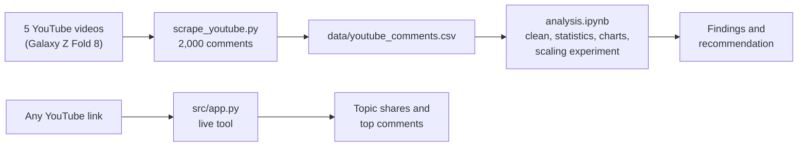
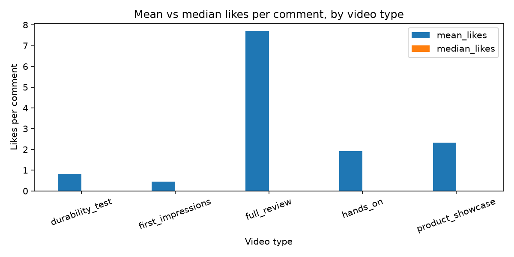
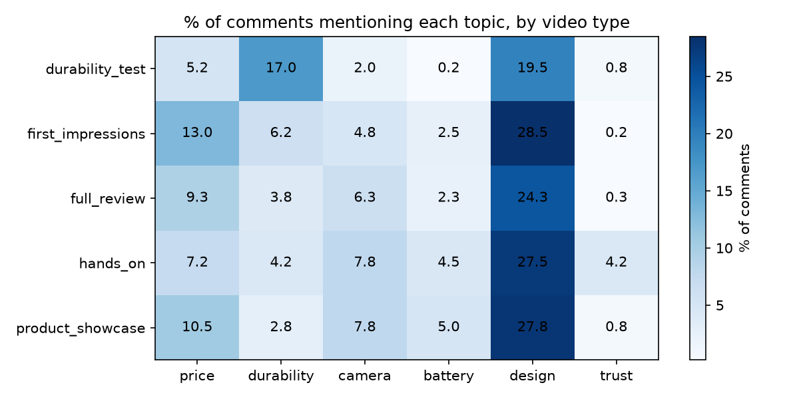

# What do viewers worry about in Samsung Galaxy Z Fold 8 videos?

Big Data Analytics (DS391), Project 1: from social-media records to a marketing decision.

A dataset of **2,000 public YouTube comments** (400 per video) from 5 videos about the same product, the Samsung Galaxy Z Fold 8, and an analysis of what viewers talk about in each type of video.

**Business question:** Do different types of review video attract different viewer concerns (price, durability, camera, battery, design, trust), and which concern should a brand address first?

## What is it useful for?

A brand, retailer or reviewer who reads thousands of comments by hand cannot see what viewers actually worry about. This project turns comments into a clear picture of viewer concerns (price, durability, camera, battery, design, trust), so a marketing team knows what to address first. The **live tool** in `src/` does the same for any YouTube video: paste a link and see the result (see "Try it on any video" below).

## How it works

1. **Collect:** `scrape_youtube.py` uses the YouTube Data API to download 400 comments from each of 5 videos about the same product (2,000 comments), with likes, replies and dates.
2. **Clean and check:** the notebook checks the record count, column types, missing values and duplicates, removes unusable rows, and adds simple columns such as comment length and topic flags (price, durability, camera, battery, design, trust).
3. **Analyze:** it compares the five video types with summary statistics and charts, then states two evidence-based observations and one marketing recommendation.
4. **Scale test:** it repeats the data up to about 2 million rows to measure how time and memory grow, and explains when a tool like Spark would be worth using.
5. **Live tool:** `src/app.py` applies the same topic idea to any YouTube link you paste, so the analysis can be reused on new videos without opening the notebook.

## Data

- **Source:** YouTube Data API v3 (`commentThreads.list`), collected on 24 Oct 2026 with `scrape_youtube.py`.
- **What was collected:** top-level comments only (no replies), the 400 most recent per video.
- **Privacy:** author names and channel IDs were not collected.
- **Licence note:** the comments belong to their authors. They are used here for educational analysis, following the YouTube API Services Terms.

| Video ID | Channel | Type (category) |
|---|---|---|
| Z6z_feacXW8 | MKBHD | full_review |
| 8Hx2yvWSgs0 | MKBHD | first_impressions |
| HZOYCMkic0E | JerryRigEverything | durability_test |
| QHuIU2oE4Hg | Mrwhosetheboss | hands_on |
| Lgwa3Ze0tv4 | Unbox Therapy | product_showcase |

### Data dictionary

One row = one top-level YouTube comment.

| Column | Type | Meaning |
|---|---|---|
| video_id | text | YouTube video ID |
| video_title | text | Title of the video |
| category | categorical | Video type, assigned by us (see table above) |
| channel | categorical | Channel name, assigned by us |
| comment_id | text | Unique comment ID |
| text | text | The comment |
| likes | number | Likes on the comment when collected |
| reply_count | number | Number of replies to the comment |
| published_at | date/time | When the comment was posted (UTC) |
| text_length, word_count | number | Derived from `text` |
| mentions_price, mentions_durability, mentions_camera, mentions_battery, mentions_design, mentions_trust | True/False | Derived: does the comment contain words from that topic's keyword list |

## Files

| File | What it is |
|---|---|
| `scrape_youtube.py` | Collects the comments with the YouTube Data API |
| `data/youtube_comments.csv` | Raw dataset (2,000 rows) |
| `data/youtube_comments_clean.csv` | Cleaned dataset with the derived columns (1,999 rows) |
| `analysis.ipynb` | Quality checks, cleaning, statistics, charts, scaling experiment |
| `figures/` | Charts saved by the notebook |
| `src/app.py`, `src/index.html` | Live tool: paste any YouTube link and analyze its comments |

## Key findings

- **A few comments get almost all the likes.** 83% of comments have 0 likes, and the top 1% of comments (19) hold about 87% of all likes. Mean likes is misleading: the full-review video has the highest mean (7.69), but its median is 0.
- **Viewer concerns change with the video type.** Price is mentioned in 13.0% of first-impressions comments and 10.5% of product-showcase comments, but only 5.2% of durability-test comments.
- **Recommendation:** a brand could test price and value messaging (for example, trade-in or bundle offers) in early launch content and compare results using the share of comments that mention price.
- **Scaling experiment:** repeating the data up to about 2 million rows (1,000x), Pandas loaded the file in 3.13 s, ran the analysis in 6.53 s and used 627.5 MB of memory. Repeated copies are a scaling experiment only, not new evidence.

## Try it on any video (live tool)

Paste a YouTube link, choose **Product mode** (review videos) or **Creator mode** (feedback on a creator's own video), and the tool shows the share of comments per topic, the most-liked examples, and a one-line summary. Spam-like comments are removed first, and the API key stays on the server.

1. `py -m pip install -r requirements.txt`
2. Make sure `.env` contains `YOUTUBE_API_KEY=your_key_here`
3. `py src/app.py`
4. Open http://127.0.0.1:5000

The tool uses the same keyword topics as the notebook. It is an addition to the project, so the analysis above does not depend on it.

## Limitations

- Only the 400 most recent comments per video were collected, and the time window differs by video.
- Each video type has only one video, so differences may reflect that channel's audience.
- Topic detection uses simple keyword lists, so it misses sarcasm and misspellings. Differences of a few percentage points may be noise.

## How to reproduce

1. Install the packages: `py -m pip install -r requirements.txt`
2. Get a YouTube Data API v3 key from Google Cloud Console and save it in a file named `.env`:
   `YOUTUBE_API_KEY=your_key_here`
   (`.env` is excluded from the repository, so the key stays private.)
3. Collect the comments: `py scrape_youtube.py`
4. Open `analysis.ipynb` and run all cells.
